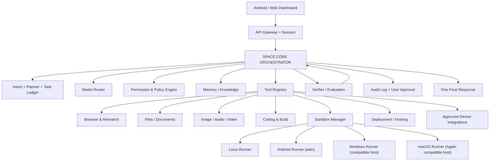
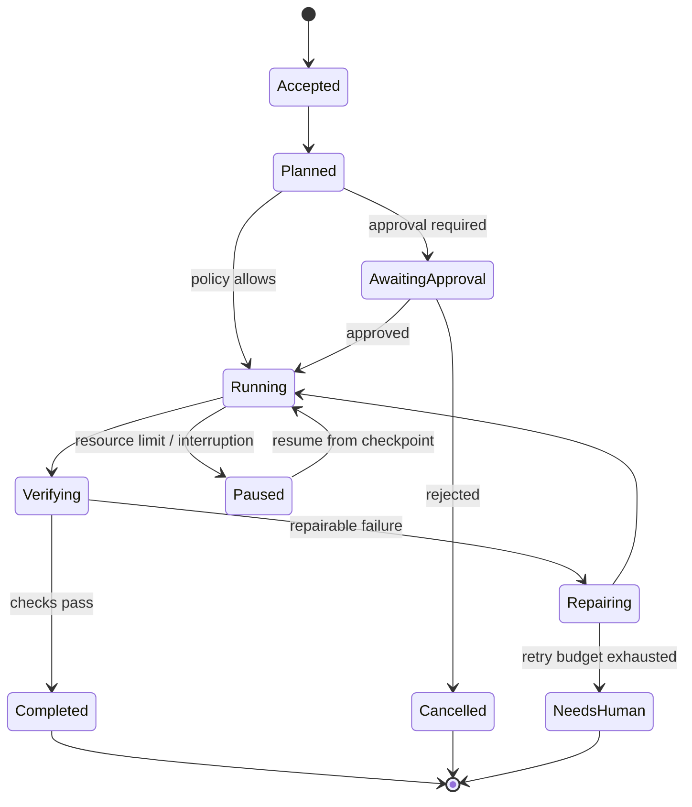

# Arsitektur AI utama space

## Model mental

space adalah **satu AI utama dengan satu pusat koordinasi**. Tool dan skill adalah kemampuan yang tersedia bagi pusat koordinasi. Pekerjaan besar boleh dipecah menjadi job internal atau worker terisolasi, tetapi hasilnya kembali ke satu task ledger dan satu jawaban AI.

## Komponen

### 1. API Gateway dan sesi
Mengelola autentikasi pengguna, sesi percakapan, upload, streaming output, rate limits, dan routing ke agent utama. Dashboard harus mobile-first dan dapat digunakan dari Android browser.

### 2. Space Core Orchestrator
Satu identitas AI yang:
- menafsirkan maksud dan constraint pengguna;
- membuat rencana terstruktur;
- memilih model dan tool yang sesuai;
- memantau job dan timeout;
- meminta persetujuan jika policy mengharuskan;
- menyatukan hasil tool;
- menjawab hanya berdasarkan bukti yang tersedia.

Jangan menaruh semua kemampuan dalam satu prompt raksasa. Gunakan tool schema, state machine, capability registry, dan kontrak input/output yang tervalidasi.

### 3. Model Router
Menyediakan abstraksi provider agar model bisa diganti berdasarkan:
- jenis tugas (coding, vision, audio, reasoning, ringkasan);
- kualitas yang diukur;
- biaya dan kuota;
- latensi dan ketersediaan;
- aturan privasi dan lokasi data.

Provider API key disimpan di secret storage, bukan di Git atau browser. Model yang berbeda tidak boleh melewati policy engine yang sama.

### 4. Tool Registry
Setiap tool mendeklarasikan:
- nama dan versi;
- schema parameter;
- permission scopes;
- apakah read-only atau write;
- kebutuhan approval;
- timeout dan resource budget;
- batas ukuran input/output;
- audit event;
- strategi rollback bila memungkinkan.

Tool tidak boleh memberikan shell arbitrer pada host. Eksekusi terminal hanya tersedia di runner/sandbox yang ditetapkan.

### 5. Browser dan research
Browser agent menggunakan sesi terisolasi. Konten web diperlakukan sebagai data tidak tepercaya, bukan instruksi sistem. Simpan URL, waktu akses, kutipan/ekstrak yang relevan, dan status sumber. Tindakan eksternal seperti posting, pembelian, pengiriman, atau pengubahan akun tunduk pada approval policy.

### 6. Memory dan knowledge
Pisahkan:
- conversation memory;
- user preferences yang disetujui;
- project memory;
- task/job state;
- verified knowledge dan sumber;
- error/evaluation records.

Setiap memory memiliki source, timestamp, owner, retention, dan mekanisme koreksi/penghapusan. Jangan menelan seluruh isi akun atau file pengguna menjadi memory permanen secara otomatis.

### 7. Sandbox Manager
Setiap pekerjaan kode berjalan di workspace/container/VM dengan:
- filesystem terpisah;
- resource quotas;
- network egress policy;
- non-root default;
- secret injection yang sempit dan sementara;
- snapshot/checkpoint;
- timeout dan kill switch;
- artefak hasil yang dapat diunduh.

Rilis awal hanya perlu Linux sandbox. Runner Windows, Android, dan macOS ditambahkan sebagai executor berbeda saat host, lisensi, dan kapasitasnya tersedia.

### 8. Scheduler dan durable jobs
Job panjang disimpan bersama checkpoint sehingga dapat dilanjutkan setelah restart. Gunakan event/schedule untuk membangunkan agent saat ada pekerjaan. Jangan membuat infinite loop yang menghabiskan CPU saat idle.

Cloudflare Agents/Durable Objects adalah kandidat untuk coordinator stateful karena mendukung state persisten, scheduler, WebSocket, dan job yang dapat pulih; Cloudflare Workflows dapat menangani proses multi-langkah yang membutuhkan retry dan checkpoint. Ini kandidat arsitektur, belum keputusan deployment final:
- https://developers.cloudflare.com/agents/runtime/
- https://developers.cloudflare.com/agents/concepts/workflows/
- https://developers.cloudflare.com/agents/concepts/agentic-patterns/long-running-agents/

### 9. Verifier dan evaluation
Setiap hasil melewati pemeriksaan yang sesuai:
- schema validation;
- test/unit/integration;
- lint/type-check;
- link/source checks;
- static security checks;
- file integrity;
- human approval untuk dampak eksternal/produksi.

Simpan bukti, jangan hanya menyimpan klaim model.

## Job lifecycle

## Batas deployment

Codespaces saat ini hanya menjadi development workspace. Jangan jadikan Codespaces satu-satunya 24/7 production host. OS runner membutuhkan host yang sesuai, dan resource gratis tetap memiliki limit. Tidak ada VM disk yang dibuat otomatis saat startup.
