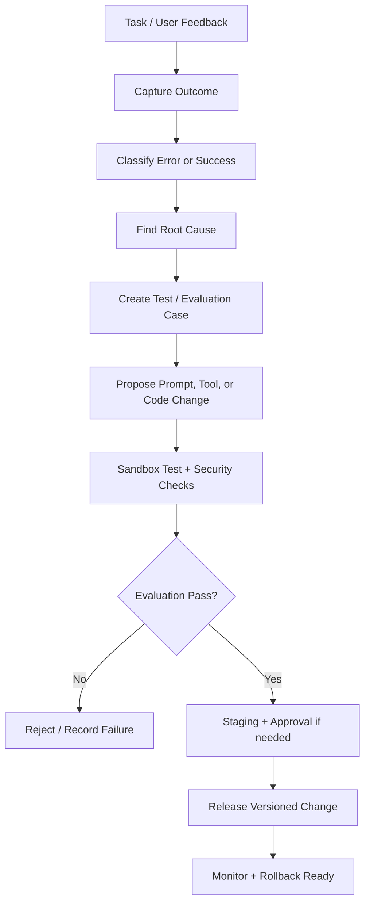

# Memori, evaluasi, dan peningkatan diri yang aman

## Bedakan memori dari pelatihan model

Mengingat preferensi pengguna atau menyimpan solusi error bukan berarti melatih ulang foundation model. Versi awal space sebaiknya memakai retrieval memory dan evaluasi terkontrol. Fine-tuning model, bila kelak dilakukan, merupakan pipeline terpisah yang memerlukan dataset berizin, evaluasi, biaya, dan rollback.

## Jenis memori

1. **Session memory:** konteks percakapan yang sedang aktif.
2. **User-approved memory:** preferensi yang pengguna pilih untuk disimpan.
3. **Project memory:** bahasa, framework, struktur, keputusan, dan batasan proyek.
4. **Task memory:** rencana, checkpoint, tool calls, status, dan hasil.
5. **Error memory:** kondisi gagal, root cause, fix, dan regression test.
6. **Knowledge memory:** fakta yang memiliki sumber dan tanggal.
7. **Evaluation memory:** benchmark, expected result, model version, dan skor.

Setiap record harus memiliki provenance (dari mana asalnya), timestamp, scope, retention, dan status verifikasi. Konten dari website/dokumen tidak otomatis menjadi fakta atau memory yang dipercaya.

## Learning loop

## Apa yang boleh diperbaiki otomatis

Dalam sandbox:
- membuat regression test;
- memperbaiki bug lokal;
- memperbarui dokumentasi;
- menyusun prompt/template;
- memperbaiki retrieval ranking;
- mengoptimalkan tool orchestration;
- mengusulkan dependency update.

Harus melalui review/approval:
- perubahan system policy;
- perubahan permission atau OAuth scopes;
- akses ke secrets;
- perubahan autentikasi;
- deploy production;
- migrasi/destruksi data;
- perubahan model/provider yang menambah biaya atau mengirim data ke pihak baru.

## Metrik

- task success rate;
- test pass rate;
- factuality/source support;
- hallucination/unsupported claim rate;
- error recurrence;
- memory retrieval precision;
- regression rate;
- latency p50/p95;
- token/compute/storage cost;
- rollback time.

Jangan menganggap satu jawaban yang disukai pengguna sebagai bukti model telah membaik. Gunakan evaluation set yang tetap, variasi test, dan regression benchmark.

## 24/7 tanpa loop tak terbatas

Agent dapat menyimpan job dan checkpoint, tidur saat tidak ada tugas, lalu bangun karena:
- user request;
- webhook/event;
- scheduled task;
- monitoring alert;
- job retry.

Sistem tidak perlu terus-menerus menghabiskan CPU ketika idle. Setiap schedule/job memiliki batas waktu, concurrency, retry count, dan budget. User dapat melihat antrean, pause, cancel, dan audit aktivitas.

Continuous operation tetap bergantung pada uptime, kuota, dan harga provider. Tidak ada janji bahwa seluruh komputasi berat berjalan gratis 24 jam.
